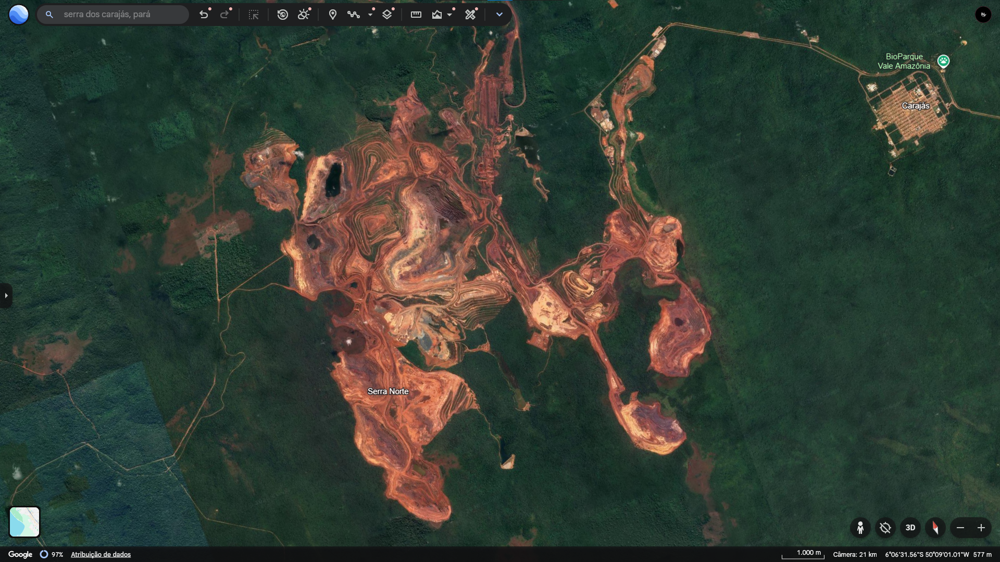
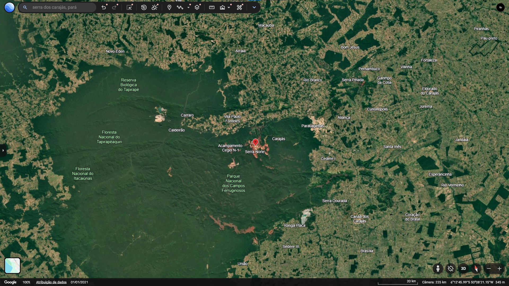
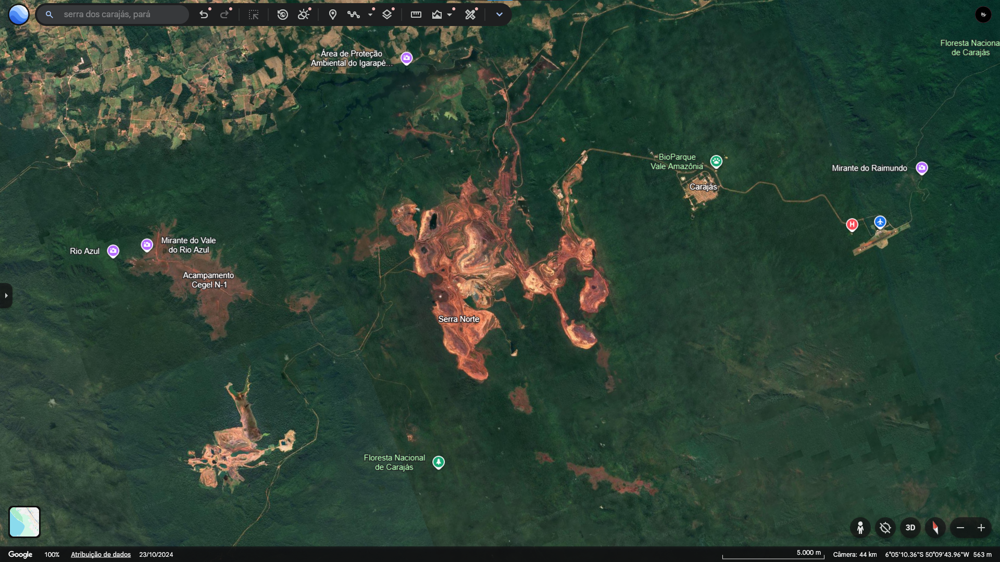
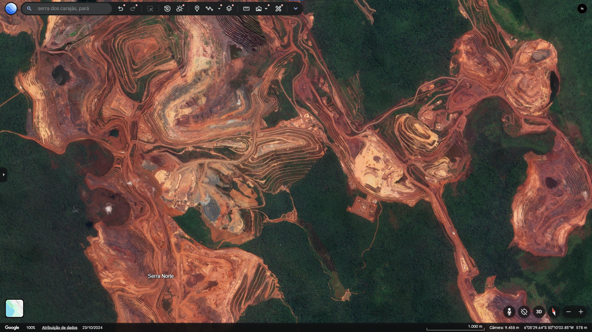

# MineVision — análise exploratória de alterações topográficas

Projeto acadêmico para comparar dois Modelos Digitais de Elevação (MDE/DEM) de uma mesma área e produzir:
- raster GeoTIFF de diferença (`posterior - anterior`);
- mapa PNG da diferença;
- histograma das diferenças;
- estatísticas em CSV;
- relatório em Markdown com limitações e metadados.

**Estudo de caso:** Serra dos Carajás, Pará, Brasil.

## Importante: o que este projeto mede
O programa calcula diferenças entre dois rasters de elevação. Ele não identifica sozinho a causa da diferença e não prova que toda variação seja mineração. Diferenças podem resultar de datas, sensores, resolução, georreferenciamento, vegetação, construções, água, erros verticais e processamento.

O Copernicus DEM GLO-30 é um **modelo digital de superfície (MDS/DSM)**, que inclui vegetação e estruturas, e seus dados foram adquiridos principalmente entre 2011 e 2015. Portanto, não use duas cópias/versões do mesmo produto como se fossem épocas distintas. Para um estudo temporal, obtenha dois produtos com datas de aquisição realmente diferentes e documentadas. Se só houver um MDE confiável, apresente o trabalho como análise do relevo atual, não como mudança temporal comprovada.

## Requisitos
- Python 3.10 ou superior
- Windows, Linux ou macOS
- Dependências: `rasterio`, `numpy`, `matplotlib`, `PySide6`

## Instalação (Windows / CMD)
Abra o CMD na pasta do projeto:

```bat
py -m venv .venv
.venv\Scripts\activate
python -m pip install --upgrade pip
pip install -r requirements.txt
```

## Executar
```bat
python main.py
```

A interface permite selecionar:
1. MDE anterior (GeoTIFF `.tif` ou `.tiff`);
2. MDE posterior (GeoTIFF `.tif` ou `.tiff`);
3. pasta de saída.

Clique em **Analisar**. Os resultados serão salvos na pasta escolhida.

## Dados de elevação
Fontes para procurar dados e registrar a proveniência:
- Copernicus DEM: https://dataspace.copernicus.eu/explore-data/data-collections/copernicus-contributing-missions/collections-description/COP-DEM
- Documentação de DEM: https://documentation.dataspace.copernicus.eu/APIs/SentinelHub/Data/DEM.html
- OpenTopography: https://opentopography.org/

O Copernicus DEM GLO-30 tem resolução nominal de 30 m e cobertura global, mas a disponibilidade/acesso e os termos devem ser conferidos no portal. Registre no trabalho o nome do produto, data de aquisição, resolução, sistema de coordenadas, fonte e data de download.

## Como interpretar
O raster de diferença é calculado como:

`diferença = MDE_posterior - MDE_anterior`

- valor negativo: superfície representada mais baixa no segundo modelo;
- valor positivo: superfície representada mais alta no segundo modelo;
- valor próximo de zero: diferença pequena em relação aos dois modelos.

**Não confunda diferença de superfície com volume de minério extraído.** Para estimar volume seriam necessários dados adequados, delimitação da área, alinhamento, resolução e avaliação de incerteza. O projeto não calcula volume.

## Estrutura
```text
MineVision/
├── main.py
├── script.py
├── areas.py
├── requirements.txt
├── src/
│   ├── __init__.py
│   ├── analise.py
│   ├── relatorio.py
│   ├── raster.py
│   ├── interface.py
│   └── interface_qt.py
├── dados/
├── resultados/
├── resultados_teste/
├── tests/
└── docs/
    └── imagens/
```

## Limitações conhecidas
- A comparação exige rasters com cobertura espacial sobreposta.
- O segundo raster é reprojetado/alinhado à grade do primeiro antes da subtração.
- O alinhamento não elimina diferenças de qualidade ou de data.
- A análise é exploratória e não substitui validação de campo ou avaliação geodésica.
- A área de estudo ainda precisa ser delimitada com coordenadas ou polígono.
- Nenhum resultado real da Serra dos Carajás é incluído neste pacote sem dados de entrada verificados.

## Citação dos dados
Siga a licença e a forma de atribuição indicadas pelo provedor do conjunto utilizado. Para Copernicus DEM, consulte a página oficial do produto e registre a referência/DOI quando aplicável.


## Computação Gráfica e Visualização Geográfica

### 1. Processamento e Tratamento de Imagens

A visualização de áreas de mineração apresenta desafios relacionados à integração de imagens de diferentes fontes e datas.

Um dos principais desafios é o stitching, processo de combinação de imagens para formar um mosaico contínuo. Durante essa etapa, podem ocorrer diferenças de alinhamento, sobreposição, iluminação e tonalidade entre imagens.

Em regiões de mineração, esses problemas podem ser intensificados por:

- Diferenças de iluminação e sombras provocadas pelo relevo.
- Alterações na vegetação entre diferentes datas de aquisição.
- Contraste entre solo exposto, vegetação, água e estruturas industriais.
- Diferenças de resolução espacial entre imagens.
- Descontinuidades visuais nas áreas de sobreposição.

Para reduzir esses problemas, sistemas de processamento geográfico podem utilizar correção radiométrica, equalização de cores, reprojeção, alinhamento espacial e técnicas de composição de mosaicos.

No MineVision, o alinhamento espacial dos modelos de elevação é realizado antes da comparação, mas a composição de mosaicos de imagens de satélite ainda não está implementada.

### 2. Design de Interface e Leis da Gestalt

A interface do MineVision busca facilitar a interpretação das informações geográficas e a navegação entre as áreas monitoradas.

Duas Leis da Gestalt relevantes para esse tipo de sistema são:

**Figura-Fundo**

A separação entre o mapa e os elementos da interface permite que o usuário identifique rapidamente a área geográfica que está sendo analisada. Contrastes adequados ajudam a destacar regiões de interesse, como cavas e áreas de alteração topográfica.

**Proximidade**

Elementos relacionados são agrupados visualmente. Informações de uma mesma área, como arquivos GeoTIFF, metadados e resultados de análise, devem permanecer próximas para facilitar sua identificação e comparação.

Esses princípios ajudam a organizar a interface e reduzir o esforço necessário para localizar informações durante a análise.

### 3. Evidência Visual — Google Earth

A imagem abaixo deverá apresentar uma região de mineração observada no Google Earth.

A captura deve mostrar elementos identificáveis do terreno, como áreas de exploração, cavas, estruturas industriais ou alterações na cobertura vegetal.

<!-- Inserir a captura de tela real nesta seção -->


### Capturas de tela — Serra Norte

As imagens abaixo demonstram diferentes escalas de visualização
da região de Serra Norte, em Carajás.

**Visão regional — 20 km**



**Visão intermediária — 5 km**



**Visão aproximada — 1 km**

